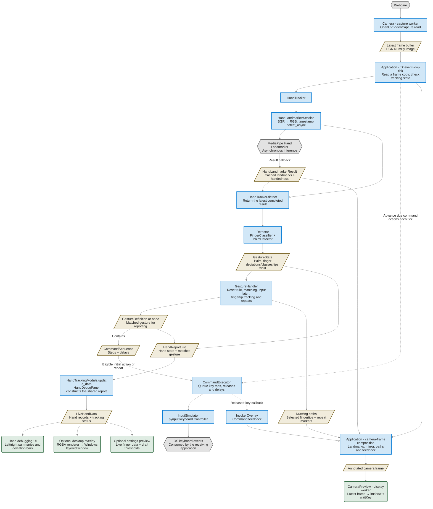
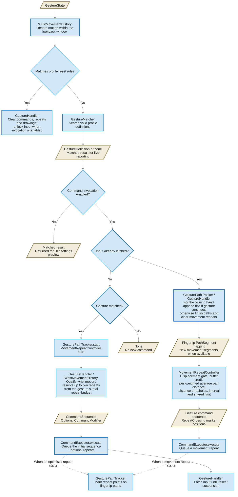
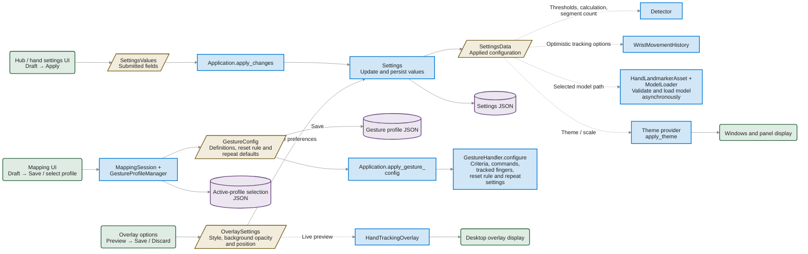

# Current core architecture

This describes the code as it stands on 2026-10-13. Solid arrows represent data
or calls; dashed arrows represent configuration, scheduling, or feedback.

How the application starts, which component owns each resource, and how it
shuts down are described in `startup_lifecycle.md`.

## Visual key

| Appearance | Meaning |
| --- | --- |
| Blue rectangle | Processing class, method, or operation |
| Blue diamond | Condition / execution branch |
| Gold parallelogram | Data object or returned result |
| Green rounded rectangle | User interface / display |
| Purple cylinder | Saved configuration file |
| Gray hexagon | External device, library runtime, or receiving application |

Data objects can themselves be Python classes; the distinction here is their
responsibility. Processing components act on values, while data objects carry
them. The shapes and theme-derived colors match `functionality_diagrams.md`.

## Webcam to commands and displays

### Important execution details

- Arrows show where information goes; data objects do not invoke the next
  component themselves. `Application` performs the calls between stages.
- `Application` receives its collaborators in three groups: `VideoIO` (camera
  and preview window), `HandPipeline` (tracker, detector, gesture handler),
  and `FrameOverlays` (everything drawn on the frame). Each group closes its
  own resources. `TrackingSwitches` holds the enable, pause, and
  command-activity switches that decide whether a frame is analyzed.
- `Application` coordinates the frame loop through Tk's `after` callbacks.
  Gesture classification, matching, command scheduling, and UI updates run on
  that thread.
- `Camera` captures independently and publishes a latest-frame buffer and a
  `CameraStatus`. The application receives a copy because it modifies the
  displayed frame, and passes the frame's aspect ratio to the detector.
- `HandLandmarkerSession.detect` submits a new image and returns its cached
  result. The returned landmarks can belong to an earlier frame; the application
  does not wait for the newly submitted image to finish inference.
- `ModelLoader` has a separate worker for creating and retiring model sessions.
  The model callback stores results and latency measurements; it does not
  update Tk widgets or simulate input.
- `CommandExecutor.execute` calls `update` immediately. A first key press can
  occur during gesture handling if the executor is free. Releases, later steps,
  and repeats are advanced on subsequent application ticks. The current key
  hold duration is 50 ms.
- Matched gesture, palm, and tracking-status changes refresh the UI immediately
  on the processing tick. Ongoing finger data with the same report identity is
  throttled to approximately 100 ms between updates.
- The desktop overlay consumes the same `LiveHandData` as the debugger. It
  does not run another detector. The camera preview has its own OpenCV window
  thread and retains only the latest submitted frame.
- Tracking respects the model status, tracking enablement, and manual pause.
  The active debugging page or enabled desktop overlay permits commands. A
  settings preview can request detection with command invocation disabled.

## Inside the gesture handler

The matcher compares the palm rule and each configured finger's allowed
classification values. Identical conflicting criteria are excluded by
`GestureCriteriaValidator`; multiple simultaneous matches are rejected by
`GestureMatcher`. Live reporting continues even when the input latch prevents
another initial command from being issued.

## Settings and profile configuration

Mapping drafts and settings drafts have separate commit operations. The
settings deviation preview evaluates draft thresholds without committing them
to the runtime detector. Saved mappings, selected profiles, and saved gesture
management changes notify the application through the mapping callback.

## Project layout

All Python code lives in the `hand_tracking/` package, except `main.py`, the
entry point. The folders inside it are namespace packages, so they have no
`__init__.py`; import each class from the module that defines it.

| Folder | Contents |
| --- | --- |
| `main.py` | Entry point and composition root |
| `hand_tracking/app/` | Application coordination: the frame loop, its collaborators, and frame timing |
| `hand_tracking/capture/` | Camera capture on a worker thread, its published status, and the preview window |
| `hand_tracking/landmarker/` | Model assets, loading, and inference for the hand landmark backend |
| `hand_tracking/gestures/` | Finger classification, gesture matching, profiles, and movement rules (`optimistic/`, `tracking/`, `repeating/`) |
| `hand_tracking/input/` | Command scheduling and keyboard simulation |
| `hand_tracking/frame_overlays/` | Drawings added to the camera frame, including the Invoker overlay and its images |
| `hand_tracking/settings/` | Settings data, validation, and persistence code |
| `hand_tracking/common/` | Dependency-free helpers and the project folder locations (`project_paths.py`) |
| `hand_tracking/ui/` | Tkinter control surface: `core/` window composition and shared state, `components/` reusable widgets, and the feature panels |
| `hand_tracking/sounds/` | Unused sound helper (see `dead_code_checklist.md`) |
| `settings/` | Saved settings and the active gesture profile selection (JSON) |
| `gesture_profiles/` | Saved gesture profiles |
| `tasks/` | MediaPipe model bundles |
| `docs/`, `tests/` | Documentation and behavior tests |

## Main code locations

| Responsibility | Location |
| --- | --- |
| Startup and dependency composition | `main.py` builds `VideoIO`, `HandPipeline`, and `FrameOverlays` (`hand_tracking/app/components.py`) |
| Frame processing and coordination | `hand_tracking/app/application.py`, `hand_tracking/app/frame_profiler.py` |
| Camera capture and device switching | `hand_tracking/capture/camera.py`, `hand_tracking/capture/camera_status.py` |
| Tracker facade and inference session | `hand_tracking/landmarker/hand_tracker.py`, `hand_tracking/landmarker/session.py` |
| Asynchronous model loading | `hand_tracking/landmarker/model_loader.py` |
| Hand landmark model (indices, fingers, handedness) | `hand_tracking/gestures/hand_landmarks.py` |
| Landmark classification | `hand_tracking/gestures/detector.py`, `hand_tracking/gestures/finger_classifier.py`, `hand_tracking/gestures/finger_thresholds.py`, `hand_tracking/gestures/palm_detector.py` |
| Gesture orchestration and matching | `hand_tracking/gestures/gesture_handler.py`, `hand_tracking/gestures/gesture_matcher.py` |
| Wrist history, paths and movement repeats | `hand_tracking/gestures/optimistic/`, `hand_tracking/gestures/tracking/`, `hand_tracking/gestures/repeating/` |
| Command scheduling and keyboard simulation | `hand_tracking/input/command_executor.py`, `hand_tracking/input/input_simulator.py` |
| Shared hand UI report and views | `hand_tracking/ui/tracking/hand/module.py`, `hand_tracking/ui/tracking/hand/debug_panel/` |
| Desktop overlay | `hand_tracking/ui/tracking/hand/overlay/`, `hand_tracking/ui/components/overlays/` |
| Camera-frame drawings and preview window | `hand_tracking/frame_overlays/`, `hand_tracking/capture/camera_preview.py` |
| Settings and gesture-profile persistence | `hand_tracking/settings/settings_manager.py`, `hand_tracking/gestures/gesture_config.py`, `hand_tracking/gestures/profile_manager.py`, `hand_tracking/common/json_storage.py`, `hand_tracking/common/config_values.py` |
