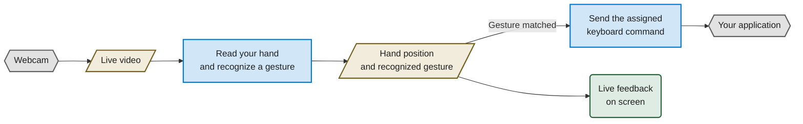
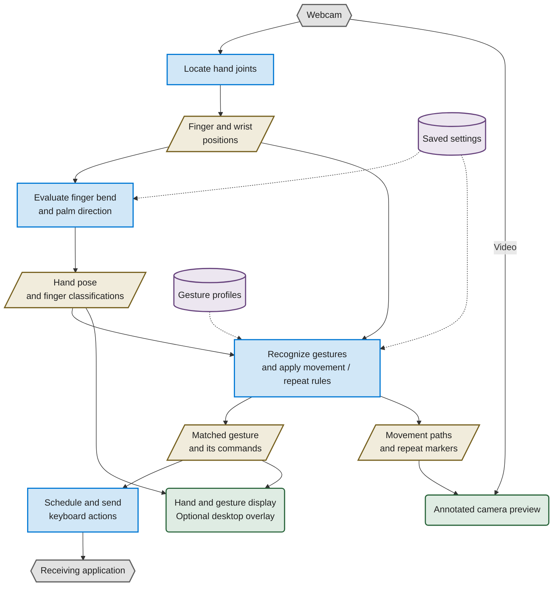
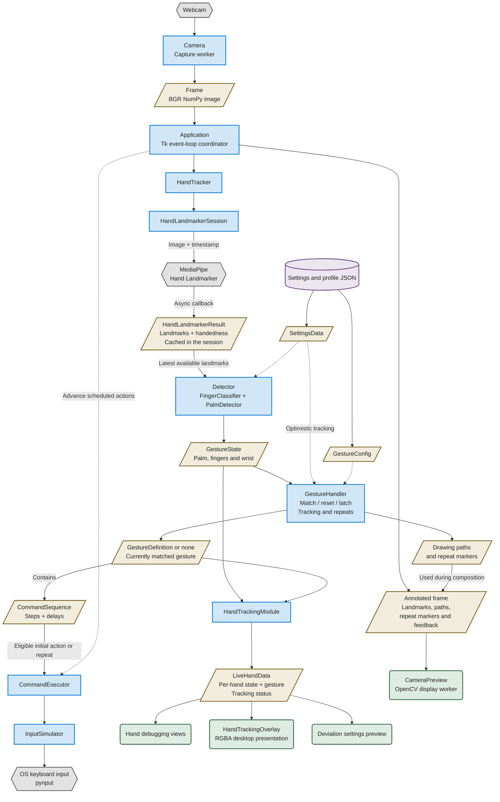

# Core functionality: three audience views

The diagrams distinguish the things that do work from the information they
exchange. Data objects can themselves be Python classes; their role here is to
carry values.

## Visual key

| Appearance | Meaning |
| --- | --- |
| Blue rectangle | Processing component; named classes in the developer view |
| Gold parallelogram | Data passed between components |
| Green rounded rectangle | User interface / display |
| Purple cylinder | Saved settings or profile files |
| Gray hexagon | External device, library runtime, or receiving application |

Solid arrows show information or results passing between nodes. Dashed arrows
show configuration or control calls. Diagram colors are derived from the
application's Light theme palette, with pale fills for readable labels.

## 1. General audience: what happens to your movement

**Audience:** Someone seeing the project for the first time.

The blue blocks do work, the gold blocks show what they learn, and the green
block shows that information to the user.

## 2. Project collaborators: processing versus information

**Audience:** A designer, collaborator, or someone interested in how the
features connect.

The processing blocks combine several implementation classes. The recognition
block includes gesture matching, wrist history, selected-fingertip tracking,
reset behavior, and repeat rules. Tracking state and the input latch determine
whether a matched gesture can send a new command.

## 3. Developers: classes, data objects, and views

**Audience:** Someone maintaining the code or tracing its data flow.

### Reading the developer view

- `Application` performs the calls between pipeline stages. The arrows show
  where information goes; data objects do not call the next component themselves.
- `HandTracker.detect` delegates to the active `HandLandmarkerSession`, which
  submits an image and returns the latest completed result. The callback and
  the application's result consumption occur independently; the application
  does not wait for that submission to finish.
- `GestureDefinition` is the match returned for reporting. Command invocation
  also depends on tracking activity, reset/latch state, and repeat eligibility.
  The path through `CommandSequence` illustrates an eligible command request.
- `HandTrackingModule` passes hand reports into `HandDebugPanel`, where
  `LiveHandData` is constructed. That same report feeds the debugger, desktop
  overlay, and settings preview.
- `GestureHandler` uses `GestureMatcher`, `WristMovementHistory`,
  `GesturePathTracker`, and `MovementRepeatController`. These helpers are
  grouped within the handler block in this view.
- `HandDrawer`, `GesturePathOverlay`, and `InvokerOverlay` contribute to the
  annotated frame under `Application`'s coordination. `CameraPreview` receives
  the finished image, not the raw path objects.
- Capture, inference, model loading, and the camera preview run outside the Tk
  thread. Classification, gesture handling, command scheduling, and ordinary
  Tk UI updates run on its event loop.
- The settings preview can use draft thresholds with command invocation
  disabled. Ongoing finger reports with unchanged gesture/status identity are
  refreshed approximately every 100 ms.

See `architecture.md` for additional handler and configuration detail.
