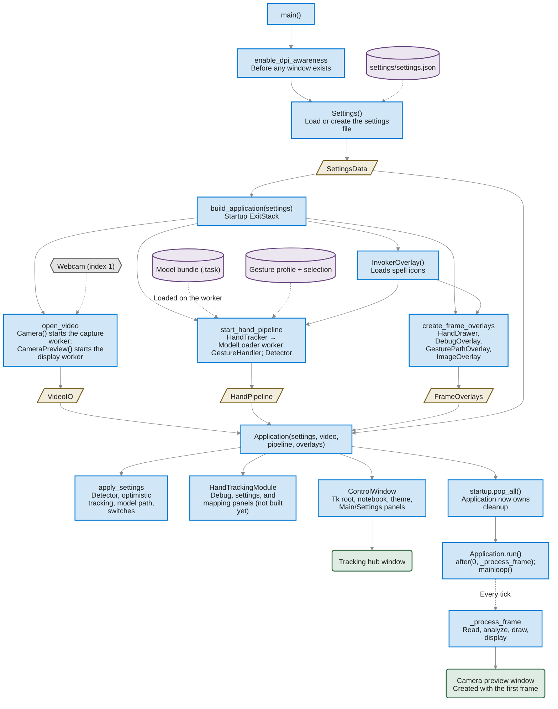
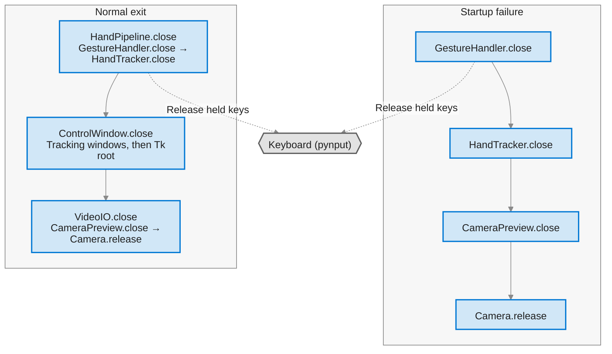

# Startup and shutdown lifecycle

This describes how `main.py` starts the application, which components own
which resources, and how everything is released. It reflects the code on
2026-10-14. The visual key matches `architecture.md`: blue rectangles do work,
gold parallelograms are data, green rounded rectangles are UI, purple cylinders
are saved files, gray hexagons are external devices or runtimes. Solid arrows
are calls or data; dashed arrows are configuration or deferred work.

## Overview

`main.py` is the composition root. It loads the settings, builds three groups
of collaborators, hands them to `Application`, and starts the Tk event loop.
Until `Application` is fully constructed, `main.py` owns cleanup; afterwards,
`Application.close` does.

| Phase | Where | Result |
| --- | --- | --- |
| 1. Prepare the process | `main()` | Windows DPI awareness; `Settings` loaded |
| 2. Build collaborators | `build_application()` | `VideoIO`, `HandPipeline`, `FrameOverlays` |
| 3. Build the application | `Application.__init__` | Settings applied; hand module and hub window created |
| 4. Run | `Application.run()` | Tk event loop with the frame loop scheduled on it |
| 5. Shut down | `Application.close()` | Input released, inference stopped, windows and devices closed |

## Startup sequence

### Step details

1. **Prepare the process.** `enable_dpi_awareness` runs first so Windows does
   not bitmap-scale any window. `Settings()` reads `settings/settings.json`,
   normalizing invalid values, or writes a default file if none exists.
2. **Open video.** `Camera()` starts its capture worker immediately and begins
   opening camera index 1. `CameraPreview()` starts its display worker, which
   waits; its OpenCV window appears only after the first frame is submitted.
3. **Start the hand pipeline.**
   - `HandTracker` starts the `ModelLoader` worker and requests the model path
     from the settings. Reading, validating, and creating the MediaPipe session
     happen on that worker, so startup does not wait for the model.
   - `GestureHandler` creates a `GestureProfileManager`, which seeds the default
     profile folder if needed, reads and rewrites
     `settings/gesture_profile_selection.json`, and loads the active profile.
     Its `CommandExecutor` creates the keyboard controller. Released keys are
     reported to the `InvokerOverlay` created just before.
   - `Detector` is configured from the current finger thresholds.
4. **Create frame overlays.** The landmark drawer is shared with the gesture
   path overlay so both use the same finger colors.
5. **Construct `Application`.**
   - `apply_settings` configures the pipeline. The model path matches the one
     already requested, so no second load is started.
   - `HandTrackingModule` creates its debugging, settings, and mapping panel
     objects. Their widgets, the tracking window, and the mapping editor's
     profile session are built later, when the user opens the workspace.
   - `ControlWindow` creates the hidden Tk root, the notebook shell, applies the
     theme and UI scale, builds the Main and Settings panels, installs input
     handling, and then shows the hub.
6. **Hand over ownership.** `startup.pop_all()` removes the startup cleanup
   callbacks; `Application.close` is now responsible for every resource.
7. **Run.** `run()` schedules the first `_process_frame` and enters the Tk
   event loop. Until the camera delivers a frame, each tick retries after
   10 ms. Until the model worker finishes, the debugging page reports
   "Loading landmarker model…" and no detection runs.

## Threads started during startup

| Thread | Started by | Stopped by |
| --- | --- | --- |
| Tk main thread | The process | `mainloop()` returning |
| Camera capture worker | `Camera()` | `Camera.release` (via `VideoIO.close`) |
| Camera preview worker (`camera-preview`) | `CameraPreview()` | `CameraPreview.close` (via `VideoIO.close`) |
| Model loader (`hand-model-loader`) | `HandTracker()` | `HandTracker.close` (via `HandPipeline.close`) |
| MediaPipe inference | The loaded `HandLandmarkerSession` | Session closed when the loader retires it |

## Ownership and cleanup

Until `startup.pop_all()`, the `ExitStack` in `build_application` closes what
has started if a later step fails. After it, `Application.close` releases
everything, including the Tk windows.

- **Normal exit.** The hub's Exit button or window close calls
  `Application.request_quit`, after any unsaved-change prompts. It sets
  `running = False` and stops the event loop; `run()` then calls `close()`.
- **Ctrl+C.** A `KeyboardInterrupt` in the event loop also ends `run()`, and
  `close()` still runs from its `finally` block.
- **Cleanup order.** `HandPipeline.close` runs first so no key stays pressed,
  then the windows close, then `VideoIO.close` stops the preview and camera.
  Each group uses an `ExitStack`, so a failure in one cleanup does not skip the
  others.
- **Failure during startup.** If any step in `build_application` raises,
  the startup `ExitStack` closes whatever had already started, in reverse:
  gesture handler, tracker, preview, camera. The exception then reaches
  `main()`.

## Restart is not a new startup

The hub's Restart button calls `Application.request_restart`. It re-requests
the current camera, forces a model reload, re-applies the gesture mapping, and
clears hand state, pause, and the Invoker overlay. Windows, panels, and the
`Settings` object are kept.

`main()` still wraps startup in a `while True` loop that would rebuild the whole
application if `Application.restart_requested` were set, but nothing sets it.
See `dead_code_checklist.md`.

## Known startup quirks

- The settings file is read twice: once by `Settings()` and again by
  `settings.load()` at the top of the restart loop.
- `ImageOverlay` reads its image from disk on every start but is never drawn.
- `InvokerOverlay` loads every spell icon on every start, but no icon is ever
  shown (`pollResult` is never called).
- The gesture profile selection is read and rewritten by the
  `GestureHandler`'s profile manager at startup, and again by a second
  `GestureProfileManager` when the hand tracking workspace is first opened
  and builds its mapping editor.
- The capture worker always starts on camera index 1; the hub's camera picker
  can switch it afterwards.
